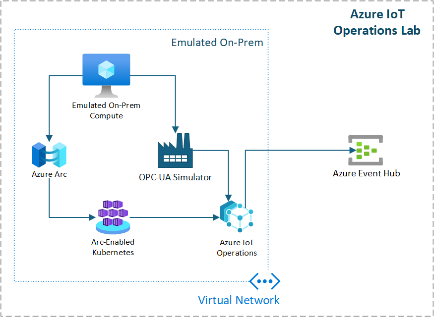
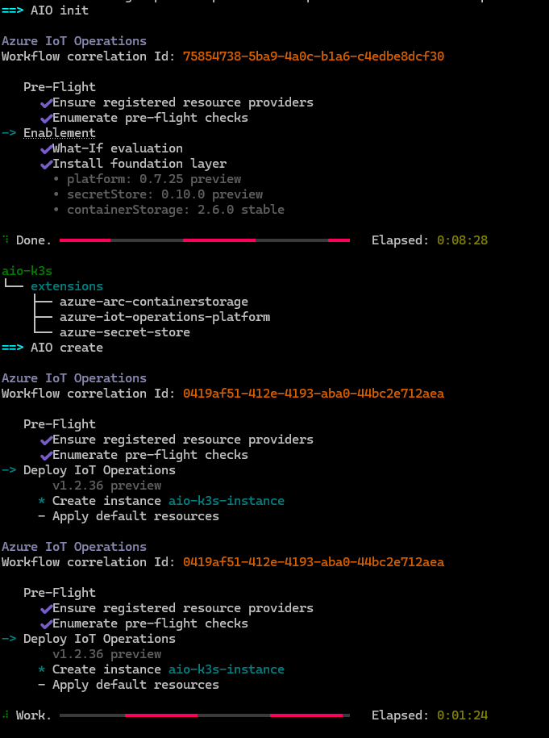

# 🚀 Azure IoT Operations Lab (Ubuntu 24.04 + K3s + Device Simulation)


Spin up an Ubuntu VM and let it **self‑provision** an end‑to‑end **Azure IoT Operations** (AIO) lab: K3s, Arc connect, AIO foundation, the **embedded quickstarts** (devices, assets, data flow), and a simulator — all from **Azure Cloud Shell** with two scripts. Tear it down with one more.

## 🖼️ Architecture Diagram



---

## ✨ What this automates

- **Arc‑enable** a K3s cluster and turn on **cluster‑connect** + **custom locations** features.  
- Deploy **Azure IoT Operations** (foundation + instance).  
- Run the two **official AIO quickstarts** end‑to‑end (this repo embeds their steps):
  - **[Deploy AIO (quickstart)](https://learn.microsoft.com/azure/iot-operations/)** 
  - **[Configure your cluster (quickstart)](https://learn.microsoft.com/azure/iot-operations/get-started-end-to-end-sample/quickstart-configure)**

> [!NOTE]
> *There is existing automated builds in the above documentation to run this in Codespaces, but the purpose of this repo is to build it out in a VM for a longer-term lab.*

---

## ⚠️ Prerequisite: Azure CLI Login

The assumption is that this deployment will be done from bash in Azure Cloud Shell. Even if you are in Cloud Shell already, it's a good idea before running the deployment script to make sure that you've logged in to Azure CLI, to set the subscription and get a refreshed token:

```bash
az login
```

Choose a region supported by Azure IoT Operations, such as `eastus2`, and ensure the selected VM size is available in that region and subscription.

---

## 🔒 Lab Security notes

- This lab uses your own Azure user credentials for all operations.
- SSH access to the VM is opened via a Network Security Group (NSG) rule.
- A local SSH key pair is generated on your local machine for authentication.

## 🧪 Quick start

```bash
git clone https://github.com/matthansen0/azure-iot-ops-lab.git
cd azure-iot-ops-lab
chmod +x *.sh
```

*Deploy the VM and start the installer*

```bash
./deploy.sh \
  --subscription "<SUB_ID>" \
  --location "eastus2" \
  --compute-rg "rg-aioCompute" \
  --ops-rg "rg-aioOps" \
  --vm-name "aio24" \
  --ssh-public-key "$HOME/.ssh/id_rsa.pub" \
  --storage-account "aio$(date +%s)" \
  --schema-registry "aioqs-sr" \
  --schema-namespace "aioqs-ns"
```

### Complete the installer sign-in

```bash
ssh -i ~/.ssh/id_rsa azureuser@<VM_PUBLIC_IP>
```

```bash
sudo tail -f /var/log/aio-install.log
```

Cloud-init starts the installer automatically. Follow the log and complete the Azure device-code sign-in when prompted; the installer takes approximately 30–45 minutes. Do not start a second copy of the installer while cloud-init is running.



### Dependency versions

The install script pins the Azure CLI extensions, Helm installer and version, upstream AIO quickstart files, and simulator image. Update these together and validate the full lab before changing the pins. The existing Ubuntu utilities intentionally follow the configured package repositories so they can receive security updates; the lab-rot watcher allows those packages but flags new unpinned packages. The Azure CLI and K3s bootstrap installers also follow their upstream releases.

Run `bash tests/test-quickstart.sh` and `bash tests/test-lab-rot-watch.sh` to check shell syntax, the pinned upstream template contract, simulator failure handling, and lab-rot detection without deploying Azure resources. The tests download the pinned quickstart files.

### Verify (optional)

```bash
# On the VM (or via Arc)
kubectl get nodes
kubectl get pods -n azure-iot-operations
kubectl get pods -n azure-arc
kubectl get pods -n cert-manager

# In Azure
az iot ops list -g rg-aioOps -o table
```

> View install logs on the VM:
>
> ```bash
> tail -40 /var/log/aio-install.log
> ```

> [!TIP]
> The quickstart's data flow sends simulator messages to an Event Hubs destination.

---

## 🗑️ Clean up

```bash
./destroy.sh --compute-rg "rg-aioCompute" --ops-rg "rg-aioOps"
```

---

## 🤝 Contributing

Contributions are welcome! If you have suggestions, bug reports, or improvements, please open an issue or submit a pull request. For major changes, please open an issue first to discuss what you would like to change.

Please ensure your pull request adheres to the existing style and includes relevant documentation or examples where appropriate.

---

## 📝 To-Do

- [ ] Add "next steps" automation for data ingestion and visualization
- [ ] Add support for password Azure-managed SSH key resources for VM login
- [ ] Add cost estimation or resource summary
- [x] Create architecture diagram
